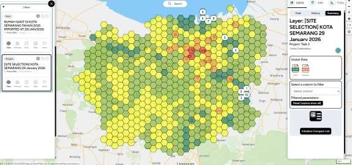
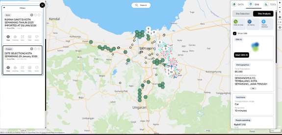

# Siting a New Hospital in Semarang City (MCDA)

Where in Semarang would a new hospital do the most good? This grid-based multi-criteria decision analysis (MCDA) scores the whole city on need, access and existing facilities to **find the most suitable sites and spread healthcare more evenly**.

Task 3 of the WebGIS Developer bootcamp (Location Analytics 2).

| Suitability grid | Site analysis |
|---|---|
|  |  |

## Criteria

| Direction | Parameters |
|---|---|
| Positive (need and access) | Population; vulnerable age groups (0–4, 70–74, ≥75 years); transport access (bus stops, terminals); employment status (not yet or not working, retired) |
| Negative (avoid crowding) | All existing health facilities: specialist hospitals, clinics, puskesmas, specialist doctor practices |

## Results

- High-priority zones (green) lie on the northern, southern and eastern edges: large populations, high shares of elderly people and toddlers, and far from a hospital.
- The city center scores low because health facilities are already dense there.
- The western edge is not recommended because of its low accessibility.
- Site analysis selects **areas 4 and 10** because they are farthest from existing hospitals while still having adequate access. Inside both areas, the location is steered toward the zone with the lowest flood susceptibility.

## Repository contents

| File | Contents |
|---|---|
| `TASK 3 _ Locataion Analytics_2_MAPID.pdf` | Full report (Indonesian) with the suitability map, site analysis and flood susceptibility |

## Tools

MAPID (grid analysis, Site Analysis by SINI)

## Author

**Arsya Dika** · [GitHub](https://github.com/ArsyaDika)

------------------

# Pemilihan Lokasi Rumah Sakit Baru Kota Semarang (MCDA)

Multi-criteria decision analysis (MCDA) berbasis grid untuk menentukan lokasi paling sesuai bagi rumah sakit baru di Kota Semarang, dengan tujuan pemerataan layanan kesehatan.

Tugas 3 bootcamp WebGIS Developer (Location Analytics 2).

| Grid kesesuaian | Site analysis |
|---|---|
|  |  |

## Kriteria

| Arah | Parameter |
|---|---|
| Positif (kebutuhan dan akses) | Jumlah penduduk; kelompok usia rentan (0–4, 70–74, ≥75 tahun); akses transportasi (halte, terminal); status pekerjaan (belum/tidak bekerja, pensiunan) |
| Negatif (menghindari penumpukan) | Semua fasilitas kesehatan yang sudah ada: rumah sakit khusus, klinik, puskesmas, praktik dokter spesialis |

## Hasil

- Zona prioritas tinggi (hijau) berada di pinggiran utara, selatan, dan timur: penduduk banyak, proporsi lansia dan balita tinggi, dan jauh dari rumah sakit.
- Pusat kota mendapat skor rendah karena fasilitas kesehatan sudah padat.
- Pinggiran barat tidak direkomendasikan karena aksesibilitasnya rendah.
- Site analysis memilih **area 4 dan 10** karena paling jauh dari rumah sakit yang ada dan tetap memiliki akses memadai. Di dalam kedua area itu, lokasi diarahkan ke zona dengan kerawanan banjir terendah.

## Isi repo

| File | Isi |
|---|---|
| `TASK 3 _ Locataion Analytics_2_MAPID.pdf` | Laporan lengkap dengan peta kesesuaian, site analysis, dan rawan banjir |

## Tools

MAPID (grid analysis, Site Analysis by SINI)

## Penulis

**Arsya Dika** · [GitHub](https://github.com/ArsyaDika)
