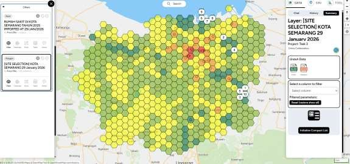
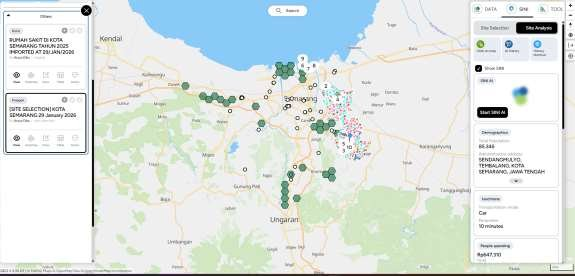

# Pemilihan Lokasi Rumah Sakit Baru Kota Semarang (MCDA)

Multi-criteria decision analysis (MCDA) berbasis grid untuk menentukan lokasi paling sesuai bagi rumah sakit baru di Kota Semarang, dengan tujuan pemerataan layanan kesehatan.

Tugas 3 bootcamp WebGIS Developer (Location Analytics 2).

| Grid kesesuaian | Site analysis |
|---|---|
|  |  |

## Kriteria

| Arah | Parameter |
|---|---|
| Positif (kebutuhan dan akses) | Jumlah penduduk; kelompok usia rentan (0–4, 70–74, ≥75 tahun); akses transportasi (halte, terminal); status pekerjaan (belum/tidak bekerja, pensiunan) |
| Negatif (menghindari penumpukan) | Semua fasilitas kesehatan yang sudah ada: rumah sakit khusus, klinik, puskesmas, praktik dokter spesialis |

## Hasil

- Zona prioritas tinggi (hijau) berada di pinggiran utara, selatan, dan timur: penduduk banyak, proporsi lansia dan balita tinggi, dan jauh dari rumah sakit.
- Pusat kota mendapat skor rendah karena fasilitas kesehatan sudah padat.
- Pinggiran barat tidak direkomendasikan karena aksesibilitasnya rendah.
- Site analysis memilih **area 4 dan 10** karena paling jauh dari rumah sakit yang ada dan tetap memiliki akses memadai. Di dalam kedua area itu, lokasi diarahkan ke zona dengan kerawanan banjir terendah.

## Isi repo

| File | Isi |
|---|---|
| `TASK 3 _ Locataion Analytics_2_MAPID.pdf` | Laporan lengkap dengan peta kesesuaian, site analysis, dan rawan banjir |

## Tools

MAPID (grid analysis, Site Analysis by SINI)

## Penulis

**Arsya Dika** · [GitHub](https://github.com/ArsyaDika)
